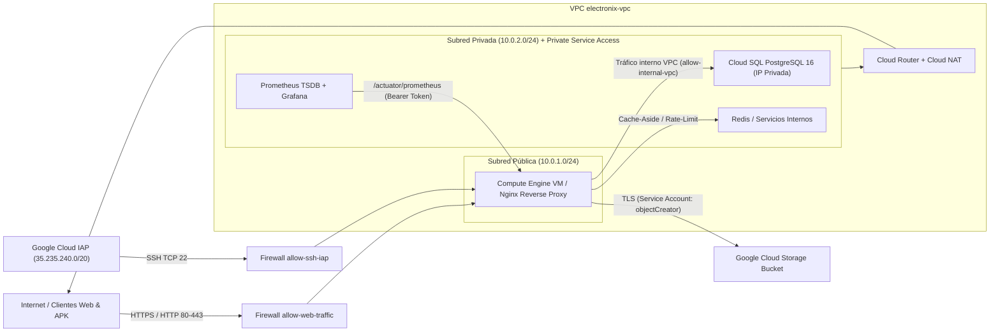

# Alineamiento Técnico del Proyecto Electronix al Programa de Servicios Cloud

Este documento mapea la arquitectura, el código fuente, la infraestructura como código (IaC), los manifiestos de contenedores/Kubernetes y las herramientas de operación de **Electronix Perú S.A.C.** frente a cada unidad y semana del sílabo del curso.

---

## Matriz General por Unidad y Semana

| Unidad | Semana | Tema del Sílabo | Implementación en Electronix | Evidencia en el Repositorio |
| :--- | :---: | :--- | :--- | :--- |
| **U1** | **1** | Computación en Nube y Sistemas Distribuidos | Arquitectura cliente-servidor desacoplada (Web/APK → Nginx → Spring Boot → Redis/PostgreSQL → GCS), JWT stateless, STOMP WebSocket, degradación elegante. | [`SecurityConfig.java`](../src/main/java/com/tienda/ecommerce/config/SecurityConfig.java), [`CacheConfig.java`](../src/main/java/com/tienda/ecommerce/config/CacheConfig.java) |
| **U1** | **2** | Virtualización (VMs y Contenedores) | Máquina Virtual Ubuntu 22.04 (`e2-medium` KVM en GCP) ejecutando servicios aislados mediante Docker (namespaces/cgroups) con usuario no-root. | [`Dockerfile`](../Dockerfile), [`terraform/main.tf`](../terraform/main.tf) |
| **U1** | **3** | Almacenamiento y Frameworks de BD | BD relacional PostgreSQL (3FN/4FN con Flyway V0–V21), almacenamiento de objetos híbrido (`local` / `gcs`), caché en memoria Redis, volumen persistente PVC. | [`GcsStorageService.java`](../src/main/java/com/tienda/ecommerce/storage/GcsStorageService.java), [`src/main/resources/db/migration/`](../src/main/resources/db/migration) |
| **U2** | **4** | Plataformas basadas en Contenedores | Multi-stage build Java 21, límites CPU/RAM (`limits`/`reservations`), red puente privada `electronix-internal`, volúmenes nombrados. | [`docker-compose.yml`](../docker-compose.yml), [`docker-compose.prod.yml`](../docker-compose.prod.yml) |
| **U2** | **5** | Multi-contenedor y Arquitectura Kubernetes | Namespace dedicado, `ConfigMap`, `Secret`, `Deployment` + `Service` (App, Postgres con PVC y probes, Redis), `Ingress` TLS. | [`k8s/`](../k8s) |
| **U2** | **6** | Modelos de Programación Distribuida (MapReduce / Hadoop / Spark) | Pipeline analítico batch OLTP → Data Lake (`gs://`) → procesamiento MapReduce / Apache Spark para ventas por categoría y segmentación RFM. | [`analytics/ventas_spark_job.py`](../analytics/ventas_spark_job.py), [`analytics/README.md`](../analytics/README.md) |
| **U2** | **7** | Redes Virtuales, Topologías, Privada y Pública | VPC personalizada (`10.0.0.0/16`), subred pública (`10.0.1.0/24`), subred privada (`10.0.2.0/24`), Cloud Router/NAT, Private Service Access, K8s `NetworkPolicy`. | [`terraform/main.tf`](../terraform/main.tf), [`k8s/06-pdb-and-networkpolicy.yaml`](../k8s/06-pdb-and-networkpolicy.yaml) |
| **U2** | **8** | Máquinas Virtuales en Nube | Instancia Compute Engine `e2-medium` con IP estática, disco `pd-balanced`, SSH restringido vía Identity-Aware Proxy (IAP) y startup script Docker. | [`terraform/main.tf`](../terraform/main.tf), [`docs/guia-despliegue-cloud.md`](guia-despliegue-cloud.md) |
| **U2** | **9** | Orquestación en Nube | IaC declarativa con Terraform (nube pública), orquestación local/VM con Docker Compose y orquestación de clúster con Kubernetes. | [`terraform/`](../terraform), [`k8s/`](../k8s) |
| **U2** | **10** | Monitoreo en Nube (TSDB, Visualización, Métricas) | Spring Boot Actuator + Micrometer → `/actuator/prometheus` (token dedicado) → Prometheus TSDB → Dashboard Grafana pre-provisionado. | [`monitoring/`](../monitoring), [`MetricsScrapeAuthFilter.java`](../src/main/java/com/tienda/ecommerce/config/MetricsScrapeAuthFilter.java), [`k8s/07-monitoring.yaml`](../k8s/07-monitoring.yaml) |
| **U2** | **11** | Escalabilidad y Elasticidad | HPA (2–5 pods por CPU/RAM), balanceo dinámico en Nginx (`resolver 127.0.0.11`), caché Redis compartido y bloqueo de login distribuido en Redis. | [`k8s/05-hpa-and-ingress.yaml`](../k8s/05-hpa-and-ingress.yaml), [`LoginAttemptService.java`](../src/main/java/com/tienda/ecommerce/auth/LoginAttemptService.java) |
| **U2** | **12** | Planificación (Scheduling) de Recursos | `requests`/`limits` (QoS *Burstable*), `podAntiAffinity`, `topologySpreadConstraints` entre zonas y `PodDisruptionBudget`. | [`k8s/04-app.yaml`](../k8s/04-app.yaml), [`k8s/06-pdb-and-networkpolicy.yaml`](../k8s/06-pdb-and-networkpolicy.yaml) |
| **U3** | **13–14** | Arquitectura y Patrones Cloud | *Cache-Aside*, *Gateway / Reverse Proxy*, *Externalized Configuration*, *Health Endpoint Monitoring*, *Stateless Auth*, *Idempotency*. | [`nginx/nginx.conf`](../nginx/nginx.conf), [`application.yml`](../src/main/resources/application.yml) |
| **U3** | **15** | Tolerancia a Fallas, Resiliencia, Confiabilidad | Degradación elegante sin Redis, bloqueo pesimista (`PESSIMISTIC_WRITE`), self-healing con pruebas automatizadas RTO y respaldos Linux/Windows a GCS. | [`scripts/test-resiliencia-falla.sh`](../scripts/test-resiliencia-falla.sh), [`scripts/backup-electronix.sh`](../scripts/backup-electronix.sh) |
| **U3** | **16–17** | Centro de Datos Empresarial: Física vs Nube | Dimensionamiento de sala física (Red, UPS, Generador, HVAC, Rack, Extinción) frente a arquitectura Cloud y TCO a 3 años. | [`docs/tco-datacenter-vs-cloud.md`](tco-datacenter-vs-cloud.md) |

---

## Detalle por Unidad

### Unidad 1: Modelos, Virtualización y Almacenamiento (Semanas 1–3)

1. **Modelos de Servicio y Deployment (Semana 1):**
   - **IaaS:** VM Compute Engine (`e2-medium`) y VPC/Firewall/NAT gestionados vía Terraform.
   - **CaaS / Orquestación:** Contenedores Docker y manifiestos Kubernetes (`k8s/`).
   - **DBaaS / PaaS:** Cloud SQL para PostgreSQL 16 (alternativa administrada en red privada).
   - **Object Storage:** Google Cloud Storage (`GcsStorageService`) para imágenes de productos y apariencia.
   - **Modelo de Deployment:** Nube Pública (GCP / AWS) con adaptador híbrido (`APP_STORAGE_TYPE=local|gcs`) que permite operar en entorno local o nube sin cambiar el código de negocio.
   - **Limitaciones evaluadas:** dependencia de conectividad WAN, costos variables por egreso de red, latencia entre capas y consistencia eventual de caché (mitigada con invalidación explícita `@CacheEvict` al actualizar stock o crear pedidos).

2. **Comparativa de Frameworks de Base de Datos y Almacenamiento (Semana 3):**

| Tecnología | Tipo | Uso en Electronix | Justificación frente a alternativas |
| :--- | :--- | :--- | :--- |
| **Cloud SQL (PostgreSQL 16)** | Relacional SQL (ACID) | **Seleccionado (Core transaccional)** | Garantiza integridad referencial 3FN/4FN, bloqueos pesimistas de stock (`PESSIMISTIC_WRITE`), triggers de protección administrativa y transacciones multi-moneda. |
| **Google Cloud Storage** | Objetos (Object Storage) | **Seleccionado (Multimedia y Backups)** | Almacena imágenes validadas (PNG/JPG/WEBP) y dumps de respaldo con versionado y URL CDN HTTPS sin saturar el disco del contenedor. |
| **Redis 7** | Clave-Valor en memoria | **Seleccionado (Caché y Rate-Limit)** | Reduce lecturas repetidas en catálogo y comparte el bloqueo por fuerza bruta (`LoginAttemptService`) entre múltiples réplicas. |
| **Cloud Spanner** | NewSQL distribuido global | No seleccionado | Diseñado para consistencia fuerte multi-región a escala global; su costo mínimo por nodo excede ampliamente el presupuesto de una pyme comercial. |
| **Cloud Datastore / Firestore** | NoSQL documental | No seleccionado | Carece de esquema relacional estricto, joins complejos de reportes y restricciones SQL nativas para inventario, facturación e historial contable. |

---

### Unidad 2: Redes, Monitoreo, Programación Distribuida y Scheduling (Semanas 4–12)

#### Topología de Red Virtual (Semana 7)

#### Monitoreo con Base de Datos de Series Temporales y Visualización (Semana 10)
- **Recolección:** `micrometer-registry-prometheus` expone métricas JVM, HTTP, HikariCP, estadísticas de caché Redis (`cache_gets_total`) y contador de seguridad (`electronix_auth_bloqueos_total`).
- **Seguridad del Scraping:** [`MetricsScrapeAuthFilter.java`](../src/main/java/com/tienda/ecommerce/config/MetricsScrapeAuthFilter.java) valida mediante comparación en tiempo constante (`MessageDigest.isEqual`) el token `PROMETHEUS_SCRAPE_TOKEN` únicamente sobre `GET /actuator/prometheus` con autoridad mínima `METRICS_SCRAPE`, manteniendo `/actuator/metrics` y `/actuator` restringidos a `CONFIGURACION_GESTIONAR`.
- **TSDB y Dashboards:** Prometheus (`prom/prometheus`) almacena series temporales con retención de 15 días y Grafana (`grafana/grafana`) carga automáticamente el datasource y el tablero [`electronix-cloud-overview.json`](../monitoring/grafana/dashboards/electronix-cloud-overview.json).

#### Escalabilidad, Scheduling y Limitaciones Conocidas (Semanas 11–12)
- En Kubernetes (`k8s/`), `electronix-app` usa `HPA` (2–5 réplicas), `requests`/`limits`, `podAntiAffinity`, `topologySpreadConstraints` y `PodDisruptionBudget` (`minAvailable: 1`).
- En Docker Compose producción ([`docker-compose.prod.yml`](../docker-compose.prod.yml)), `ecommerce-app` no fija `container_name` y [`nginx.conf`](../nginx/nginx.conf) utiliza `resolver 127.0.0.11` para permitir escalado horizontal (`--scale ecommerce-app=2`).
- **Sincronización WebSocket multi-réplica:** [`ChatPubSubBridge.java`](../src/main/java/com/tienda/ecommerce/chat/ChatPubSubBridge.java) propaga mensajes STOMP entre réplicas mediante Redis Pub/Sub (`electronix:chat:broadcast`) y degrada a entrega local si Redis no está disponible.

---

### Unidad 3: Resiliencia, SLA/RTO/RPO y Centro de Datos (Semanas 13–17)

- **Objetivos de Confiabilidad:**
  - **SLA objetivo:** `>= 99.9%` mensual.
  - **RTO (Recovery Time Objective):** `< 15 minutos` en infraestructura completa; `< 60 segundos` en autorecuperación de contenedor (`docker kill` + `restart: always` o Kubernetes `ReplicaSet`).
  - **RPO (Recovery Point Objective):** `< 15 minutos` con respaldo automatizado (`scripts/backup-electronix.sh` hacia GCS o `PITR` habilitado en Cloud SQL).
- **Patrones Cloud implementados:**
  1. *Cache-Aside transaccional + Graceful Degradation* (`.transactionAware()` difiere invalidaciones hasta `afterCommit`; si Redis cae en lectura o invalidación, degrada hacia PostgreSQL sin abortar el checkout y registra `electronix.cache.evict.errors`).
  2. *Pessimistic Concurrency Control* (`PESSIMISTIC_WRITE` en `PedidoServiceImpl`) para prevenir sobreventa bajo carga concurrente.
  3. *Externalized Configuration & Least Privilege IAM* (`.env` / `ConfigMap` / `Secret`, `objectCreator` en GCS, `legacyObjectReader` público sin listado de objetos).
