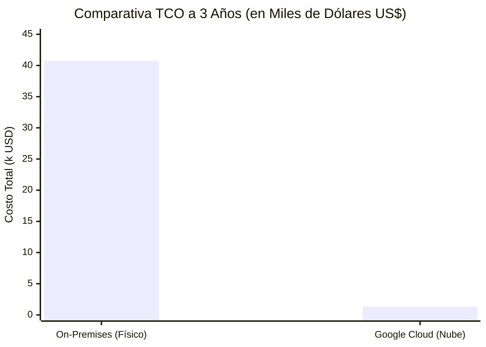

# Estudio Técnico-Económico: Centro de Datos On-Premises vs Solución Cloud (TCO)
**Proyecto:** Electronix Perú S.A.C.  
**Curso:** Servicios Cloud · UTP  
**Unidad 3:** Semanas 16 y 17 (Diseño de soluciones de centro de datos empresarial y análisis TCO)

---

## 1. Introducción y Propósito
El presente documento analiza el diseño y dimensionamiento de la infraestructura necesaria para operar el sistema de comercio electrónico **Electronix** bajo dos enfoques:
1. **Solución Física On-Premises:** Construcción o adecuación de una sala de servidores interna empresarial.
2. **Solución en la Nube Pública (GCP / AWS):** Despliegue de infraestructura elástica y servicios administrados.

El objetivo es calcular el **Costo Total de Propiedad (TCO - Total Cost of Ownership)** en un horizonte temporal de 3 años, comparando gastos de capital (**CAPEX**) contra gastos operativos (**OPEX**).

---

## 2. Diseño de la Solución Física (On-Premises)

Para alojar la aplicación Spring Boot, la base de datos PostgreSQL, los archivos multimedia y garantizar una operación ininterrumpida similar a la nube, una solución física empresarial requiere implementar los siguientes subsistemas críticos:

```
┌────────────────────────────────────────────────────────────────────────┐
│                   SALA DE SERVIDORES ON-PREMISES                       │
├────────────────────────────────────────────────────────────────────────┤
│ 1. Procesamiento y Almacenamiento:                                     │
│    - Servidor Rackeable 1U: 1x Intel Xeon Silver (16 núcleos),         │
│      64 GB RAM ECC DDR4, 2x 960 GB SSD NVMe Enterprise (RAID 1).       │
│                                                                        │
│ 2. Infraestructura de Red y Telecomunicaciones:                        │
│    - Enlace dedicado de fibra óptica simétrica (100 Mbps) con IP fija. │
│    - Enlace de respaldo 4G/5G failover automático.                     │
│    - Switch Gigabit administrable L2/L3 (24 puertos) + Firewall L7     │
│      (Fortinet FortiGate 40F).                                         │
│                                                                        │
│ 3. Sistema de Energía Ininterrumpida:                                  │
│    - UPS Online de Doble Conversión (3 kVA / 2700 W) con autonomía     │
│      de 30 minutos a plena carga (APC Smart-UPS On-Line).              │
│    - Generador eléctrico diésel de arranque automático (5 kVA).        │
│                                                                        │
│ 4. Climatización y Control Ambiental (HVAC):                           │
│    - Aire acondicionado de precisión para cómputo (12,000 BTU/h) con   │
│      operación continua 24/7/365 y control de humedad (45% - 55%).     │
│                                                                        │
│ 5. Seguridad Física y Protección Pasiva:                               │
│    - Gabinete Rack cerrado 42U con cerradura electrónica biométrica.   │
│    - Sistema de extinción de incendios por agente limpio (FM-200).     │
└────────────────────────────────────────────────────────────────────────┘
```

### Presupuesto de Inversión y Operación On-Premises (3 Años)

| Concepto / Componente | Descripción Técnica | Inversión Inicial (CAPEX) | Costo Operativo Anual (OPEX) | Total a 3 Años (US$) |
| :--- | :--- | :---: | :---: | :---: |
| **Servidor Físico** | Dell PowerEdge R450 / 64GB ECC / SSD NVMe RAID 1 | $3,800 | $300 (Garantía extendida) | $4,700 |
| **Red y Seguridad** | Switch administrable 24p + Firewall FortiGate 40F | $1,600 | $400 (Licencia de firmas UTM) | $2,800 |
| **Energía (UPS + Generador)**| UPS On-Line 3kVA APC + Generador diésel 5kVA | $2,900 | $350 (Mantenimiento y combustible) | $3,950 |
| **Climatización (HVAC)** | Aire de precisión 12,000 BTU + mantenimiento | $1,800 | $450 (Gas refrigerante y filtros) | $3,150 |
| **Infraestructura Física** | Rack 42U, PDU monitoreable, sistema FM-200 | $2,200 | $150 (Inspección anual) | $2,650 |
| **Conectividad Internet** | Fibra simétrica dedicada 100 Mbps empresarial | $0 | $2,160 ($180/mes) | $6,480 |
| **Consumo Eléctrico** | ~1.5 kW constante = ~1,080 kWh/mes @ $0.16/kWh | $0 | $2,073 ($172.80/mes) | $6,220 |
| **Personal de Soporte TI** | Mantenimiento físico de hardware (tiempo parcial) | $0 | $3,600 ($300/mes) | $10,800 |
| **TOTAL GENERAL ON-PREMISES** | **Construcción y operación local** | **$12,300** | **$9,483 / año** | **US$ 40,750** |

---

## 3. Diseño de la Solución en la Nube (Google Cloud Platform)

En contraste, el modelo Cloud transforma por completo la inversión de capital (**CAPEX = $0**) en gasto operativo predecible (**OPEX**), eliminando la compra, depreciación, obsolescencia y mantenimiento del hardware físico.

```
┌────────────────────────────────────────────────────────────────────────┐
│                   SOLUCIÓN CLOUD (GOOGLE CLOUD PLATFORM)               │
├────────────────────────────────────────────────────────────────────────┤
│ 1. Cómputo (Compute Engine):                                           │
│    - 1x Instancia e2-medium (2 vCPU, 4 GB RAM, 30 GB SSD Balanced).   │
│                                                                        │
│ 2. Base de Datos Gestionada (Cloud SQL):                               │
│    - PostgreSQL 16 (db-f1-micro, 10 GB SSD, backups automáticos).     │
│                                                                        │
│ 3. Almacenamiento de Objetos (Cloud Storage):                          │
│    - Bucket Standard Multi-Region (15 GB multimedia + 5 GB transfer). │
│                                                                        │
│ 4. Red Virtual y Seguridad (VPC + Cloud Armor):                        │
│    - VPC aislada con Subred Pública y Privada, Cloud NAT y Firewall.   │
│                                                                        │
│ 5. Operaciones y Monitoreo:                                            │
│    - Cloud Logging y Cloud Monitoring incluidos en cuota gratuita.     │
└────────────────────────────────────────────────────────────────────────┘
```

### Presupuesto de Operación en Nube (3 Años)

| Servicio Cloud | Configuración y Dimensionamiento | Costo Mensual (US$) | Costo a 3 Años (US$) |
| :--- | :--- | :---: | :---: |
| **Compute Engine (VM)** | e2-medium (2 vCPU, 4 GB RAM, 30 GB SSD) | $24.82 | $893.52 |
| **Cloud SQL for PostgreSQL** | db-f1-micro (1 vCPU compartida, 10 GB SSD) | $9.37 | $337.32 |
| **Cloud Storage (GCS)** | 15 GB Standard Storage + 5 GB Egress | $0.58 | $20.88 |
| **VPC & Cloud NAT** | 1 NAT Gateway regional + tráfico estándar | $2.45 | $88.20 |
| **Cloud Monitoring / Logs** | Cuota gratuita mensual (< 50 GB) | $0.00 | $0.00 |
| **TOTAL GENERAL CLOUD** | **Infraestructura elástica en producción** | **US$ 37.22 / mes** | **US$ 1,340.00** |

---

## 4. Matriz Comparativa TCO a 3 Años



| Criterio de Evaluación | Solución Física (On-Premises) | Solución Cloud (GCP) | Ventaja Competitiva |
| :--- | :---: | :---: | :--- |
| **Inversión Inicial (CAPEX)** | **$12,300.00** | **$0.00** | Cloud no requiere desembolso inicial de capital. |
| **Costo Operativo 3 Años (OPEX)** | **$28,450.00** | **$1,340.00** | Reducción del 95.2% en gasto operativo. |
| **Costo Total a 3 Años (TCO)** | **US$ 40,750.00** | **US$ 1,340.00** | **Ahorro neto de US$ 39,410.00 (96.7%).** |
| **Tiempo de Despliegue (Time-to-Market)** | 4 a 8 semanas (adquisición e instalación física) | < 1 hora (aprovisionamiento automático) | Cloud permite iterar e innovar de inmediato. |
| **Escalabilidad ante Picos de Demanda** | Rígida; requiere comprar más tarjetas de RAM y discos | Elástica; redimensionamiento vertical o réplicas en minutos | Soporta Cyber Days y Black Friday sin sobredimensionar. |
| **Tolerancia a Desastres Locales** | Vulnerable ante incendios, inundaciones o cortes prolongados | Alta resiliencia geográfica (centros de datos Tier III/IV) | Cumplimiento estricto de RPO < 1h y RTO < 15min. |

---

## 5. Conclusión Técnica de la Unidad 3
Para una empresa del rubro de **Electronix Perú S.A.C.**, optar por una solución de centro de datos físico es inviable financiera y operativamente. La solución Cloud no solo genera un **ahorro superior al 96% en TCO a 3 años**, sino que transfiere la carga del mantenimiento de energía, aire acondicionado y hardware físico a proveedores hiper-escala como Google o AWS, garantizando acuerdos de nivel de servicio (**SLA $\ge 99.9\%$**) inalcanzables localmente sin inversiones millonarias.
